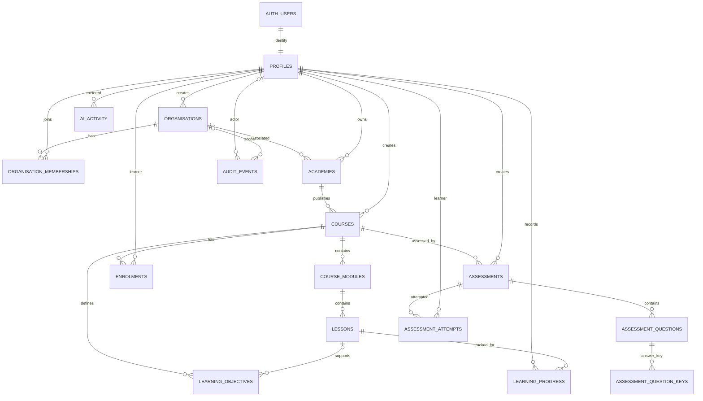

# Learnora database model and ERD

## 1. Current remote model — verified

The remote project currently contains 16 public application tables. All 16 have RLS enabled. The following diagram reflects observed foreign-key relationships, not every column or policy.

### Existing tables and key relationships

| Table | Purpose | Key relationship/constraint |
|---|---|---|
| `profiles` | User profile | PK/FK `id → auth.users.id` |
| `organisations` | Organisation/tenant root | `created_by → profiles.id`; unique slug |
| `organisation_memberships` | Contextual membership and role | FK to organisation and profile; unique organisation/user |
| `academies` | Educator academy | Owner profile; optional organisation; unique slug |
| `courses` | Course catalogue | Academy and creator; unique academy/slug |
| `course_modules` | Ordered modules | Course; unique course/position |
| `lessons` | Lesson content | Module; unique module/position |
| `enrolments` | Learner-course relationship | Course and learner; unique course/learner |
| `learning_objectives` | Outcomes | Course and optional lesson |
| `learning_progress` | Learner lesson progress | Learner and lesson; unique learner/lesson |
| `assessments` | Assessment metadata | Course and creator |
| `assessment_questions` | Learner-visible question data | Assessment; unique assessment/position |
| `assessment_question_keys` | Protected answer keys | Question; RLS restricted to academy managers |
| `assessment_attempts` | Learner attempts and results | Assessment, learner and optional grader; unique assessment/learner/attempt number |
| `ai_activity` | AI usage metering | User profile |
| `audit_events` | Audit events | Optional actor and organisation |

## 2. Proposed target domains — additive only

Do not create these tables until an implementation phase requires them and the current schema has been checked for equivalent fields. Names below are proposed logical names, not deployed objects.

| Domain | Proposed entities | Principal relationships |
|---|---|---|
| Curriculum | `curriculum_frameworks`, `framework_versions`, `subjects`, `programmes`, `programme_courses` | Framework version → subjects/programmes; programme → courses |
| Educator governance | `educator_profiles`, `educator_credentials`, `verification_cases`, `academy_memberships`, `content_versions` | Educator profile → user; credential/case → educator; academy team → academy/user; content version → course/module/lesson |
| Guardian/child | `guardian_relationships`, `consent_records`, `age_band_policies` | Guardian and learner both reference profiles; consent references relationship, purpose and version |
| Institution | `institutions`, `campuses`, `departments`, `academic_terms`, `classes`, `class_memberships`, `educator_allocations`, `timetables` | Institution → campus → department → class; class membership → user/class/term |
| Learning evidence | `learning_activities`, `progress_events`, `competency_frameworks`, `competencies`, `competency_prerequisites`, `learner_evidence`, `mastery_decisions` | Activity → lesson/objective; progress event → learner/activity; evidence → learner/competency/source assessment |
| AI intelligence | `ai_conversations`, `ai_messages`, `ai_workflow_versions`, `knowledge_sources`, `knowledge_chunks`, `retrieval_events`, `ai_evaluations`, `safety_events` | Conversation → user/scope; chunk → source/version; retrieval → conversation/chunk; evaluation → workflow/version |
| Community | `communities`, `community_memberships`, `discussions`, `discussion_replies`, `group_projects`, `conversations`, `conversation_memberships`, `messages`, `moderation_reports`, `moderation_actions` | Community → tenant/course/academy; posts → author/community; message → conversation; moderation case → content/user/action |
| Commerce | `products`, `prices`, `subscriptions`, `orders`, `order_items`, `payment_transactions`, `payment_events`, `refunds`, `ledger_accounts`, `ledger_journals`, `ledger_entries`, `educator_earnings`, `payout_records`, `reconciliation_runs` | Order → items/payments; journal → balanced entries; earnings → order/course/educator; payout → earnings/settlement |
| Credentials/opportunities | `credentials`, `credential_events`, `opportunities`, `opportunity_sources` | Credential → issuer/recipient/programme; events → issue/revoke; opportunity → verified source |
| Governance/integrations | `consent_records`, `retention_policies`, `data_subject_requests`, `integration_connections`, `webhook_receipts` | Data request → subject/purpose/status; integration → tenant/provider; webhook receipt → provider event/idempotency |

## 3. Critical constraints and invariants

- Every person maps to one `auth.users.id` and one profile; multiple roles are memberships, not duplicate accounts.
- Tenant-scoped tables carry an organisation/institution scope or derive it through a constrained parent relationship. RLS must validate the full path.
- Unique membership constraints prevent duplicate active identities in one organisation.
- Course/module/lesson ordering uses scoped unique positions.
- Course slugs are unique within an academy; academy slugs are globally unique unless an explicit namespace model is introduced.
- Enrolment uniqueness is learner/course. Re-enrolment after cancellation requires a defined lifecycle, not duplicate rows.
- Progress is event/evidence-backed; client writes cannot directly set mastery or overwrite completed evidence.
- Assessment attempts are immutable after submission except for a controlled grading workflow with an audit record. Answer keys never share the learner-readable question table.
- Payment events are idempotent by provider/event ID. Ledger journals balance: total debits equal total credits per currency.
- Financial amounts use integer minor units and an explicit ISO currency code.
- Credential identifiers are unique; revocation is append-only/audited.
- Every external content item stores provenance, rights/licence, language, version and source.
- Retention and deletion rules must account for statutory/contractual holds and educational record obligations before physical deletion.

## 4. Indexing and query strategy

Retain primary/unique indexes. Add indexes only for observed query paths:
- `organisation_memberships(user_id, status)` and `(organisation_id, role, status)`.
- `courses(publication_status, subject, education_level)`.
- `enrolments(learner_id, status)` and `(course_id, status)`.
- `learning_progress(learner_id, status)`.
- `assessment_attempts(learner_id, created_at desc)`.
- Foreign-key lookup indexes for parent/child joins.
- Commerce indexes on provider event ID, order state, settlement date and ledger account/time.
- Tenant-leading composite indexes for institution reporting.

Supabase currently reports unused indexes on the empty/new database. Do not remove them until production-like workload and query plans justify it.

## 5. Migration and test protocol

1. Reconcile all six existing remote migrations into the repository before any CLI push.
2. Apply additive migrations to a disposable Supabase branch/staging project first.
3. For every table, verify RLS enabled, explicit grants, policies for SELECT/INSERT/UPDATE/DELETE and safe helper-function execution grants.
4. Test positive and negative access paths with at least two users and two tenants.
5. Test duplicate webhook, refund and payout idempotency under concurrent requests.
6. Test content version updates do not mutate old attempts or credential evidence.
7. Run advisor checks and inspect query plans after migrations.
8. Never use service-role credentials in frontend tests or expose them in logs.
