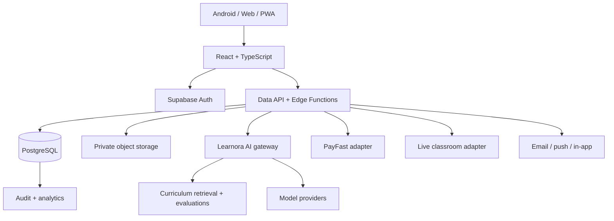

# Learnora — 360° target architecture and seven-system specification

**Brand:** Learnora  
**Slogan:** Where Potential Becomes Possibility.  
**Initial market:** South Africa  
**Product promise:** Human-centred education, intelligent technology, measurable learning outcomes.

## 1. Product architecture

Learnora is one connected platform built around seven operating systems:

1. Learning experience.
2. Educator business infrastructure.
3. Proprietary educational intelligence.
4. Educational community and collaboration.
5. Institutional education infrastructure.
6. Academic intelligence, progression and opportunity.
7. Commercial operating system and market acquisition.

Shared platform foundations: one identity system, contextual memberships and permissions, one educational data model, one auditable financial ledger, one governed AI layer, one trust/safety system and consistent observability.

Start as a modular monolith. Keep domain boundaries and server-side contracts explicit. Introduce background workers or independently deployed AI services only when workload, reliability or security needs justify the operational cost.

## 2. Shared identity, tenancy and permissions

A person has one Supabase Auth identity and can participate in multiple contexts: learner, educator, academy owner, guardian, institution administrator or finance user. Role claims supplied by the browser are never authoritative. Every privileged request derives the actor from the verified JWT, resolves current membership and resource scope from PostgreSQL, and enforces access in RLS and server-side code.

| Role/context | Allowed scope |
|---|---|
| Anonymous | Published public academy/course metadata only |
| Learner | Own profile, enrolments, progress, attempts and joined communities |
| Educator | Own educator profile and assigned academy resources |
| Academy owner/admin | Academy team, content and scoped learner operations |
| Guardian | Linked learner information covered by verified relationship, consent and policy |
| Institution owner/admin | Own tenant configuration and permitted reporting |
| Academic manager | Assigned departments/classes and scoped academic records |
| Educator/assistant | Assigned classes and learners only |
| Finance administrator | Permitted tenant/platform finance records |
| Moderator/support | Explicit case scope, reason and audit record |
| Platform administrator | Least-privilege platform governance; sensitive access audited |

All access tests must include anonymous, authenticated, cross-user, cross-academy, cross-tenant, revoked membership and direct API attempts.

## 3. Seven-system specification

### System 1 — Complete learning experience

**Objective and users:** Help school, university, vocational and lifelong learners discover structured learning, make progress and demonstrate mastery.

**Problems/value:** Fragmented content, passive course completion, unclear next steps and connectivity constraints. Learnora offers structured pathways and evidence-based progression.

**Requirements and workflow:**
- Configurable hierarchy: framework → subject → programme → course → module → lesson → activity → assessment → outcome.
- CAPS, NSC and matric mapping is curriculum data with versioned provenance, not hard-coded UI logic.
- Discovery by subject, level, language, delivery mode, educator, academy, price and credential status.
- Learner path: goals → diagnostic baseline → prerequisites → recommended pathway → content/activity → assessment → misconception feedback → reinforcement → reassessment → evidence-backed mastery → next objective.
- Distinguish content consumption from learning evidence. Video watch time alone never awards mastery.
- Support self-paced, live, blended, collaborative, text, video, audio, interactive and practical learning.
- Accessibility: captions, transcripts, playback controls, keyboard support, screen readers and contrast.
- Low bandwidth: responsive Android-first UI, adaptive media, compressed resources, authorised downloads, resumable uploads and queued progress events.
- Offline conflict policy: assessment results are server-authoritative; no silent last-write-wins for scores or completed evidence.

**Data:** Reuse courses, course_modules, lessons, enrolments, learning_objectives, learning_progress, assessments, assessment_questions, assessment_question_keys and assessment_attempts. Add framework/subject/programme registries, learning activities, progress event history, competency definitions and evidence links only where the current schema does not already represent the concept.

**Server workflows:** discovery, course detail, free/paid entitlement check, enrol, lesson content, progress event, attempt submission, learner next-action and mastery recomputation.

**Permissions:** public catalogue fields are public only by policy; lesson content requires entitlement; learners access their own evidence; educators manage only their academy; institutions access only rostered learners.

**AI/integrations/security:** curriculum-grounded tutoring and explainable suggestions; signed resource URLs; content rights; no client-supplied mastery scores.

**Revenue/operations:** free access, learner subscriptions and sponsored seats. Monitor learning objective achievement, assessment improvement, retention, time-to-mastery and sync conflict rate.

**Acceptance/testing:** unpaid content remains locked; duplicate enrolment is prevented; learner A cannot read learner B; content revisions preserve prior assessment evidence; watching a video cannot mark mastery; offline conflict tests preserve submitted scores.

**Dependencies:** identity/RLS → course/enrolment → lessons/assessments → progression/offline → adaptive intelligence.

### System 2 — Educator business infrastructure

**Objective and users:** Let independent educators, tutor teams and education providers establish and grow professional digital academies.

**Problems/value:** Fragmented website, LMS, payments, analytics and learner management. Learnora provides one operating environment while educators retain control of their content and delivery.

**Requirements/workflow:**
- Educator onboarding, professional biography, experience, subject/language, credentials and private verification evidence.
- Explicit states: unverified, pending, additional information required, verified, suspended and rejected.
- Academy branding, public profile, team memberships, catalogue, pricing, enrolment settings, learner management, announcements and analytics.
- Course studio with draft, preview, scheduled publishing, version history and archive.
- AI-assisted planning, curriculum mapping, question/rubric drafting and accessibility support; educator approval required before publishing.
- Transparent commercial statement separating gross receipts, payment fees, refunds, platform commission, accrued earnings, settlement and payouts.

**Data:** Reuse academies, courses, modules, lessons and organisation memberships. Add educator_profiles, educator_credentials, verification_cases, academy_memberships, content_versions, product/price configuration and analytics views only after schema reconciliation.

**Server workflows:** verification submission/review, academy create/update, team membership, course/module/lesson authoring, content publication, version history, educator reporting and statements.

**Permissions:** educators own their profile; academy owner/admin manage only assigned academy; platform reviewers decide verification; learner data visible only where needed for teaching.

**Security/AI:** credentials in private storage; verification decisions audited; AI outputs are drafts; no direct client mutation of earnings or payout state.

**Revenue:** Starter/Professional/Academy subscription plans, course commission, tutoring and paid live classes. Prices remain configuration, not literals in UI.

**Acceptance/testing:** unverified educator cannot show verified status; cross-academy writes fail; publish creates a version; historical attempts remain unchanged; payout request cannot exceed reconciled available balance.

**Dependencies:** identity/memberships → academy and course studio → commerce → teacher intelligence.

### System 3 — Proprietary Learnora AI intelligence

**Objective and users:** Improve learning and teaching through owned workflows, retrieval, context, evaluation and cost governance while using interchangeable foundation models.

**Requirements/workflow:**
- Provider-independent gateway with routing, retries/timeouts, fallback, quotas, token/cost limits and circuit breakers.
- Specialised workflows: Learnora Tutor, Teacher Intelligence, Assessment Intelligence, Learning Intelligence, Language Intelligence and Academic Intelligence.
- Curriculum-aware retrieval with source owner, licence, framework, subject, grade, language, version and provenance.
- Learner context is minimal, purpose-bound and permission-filtered.
- Tutor teaches by hints, step-by-step explanation, worked examples and misconception repair, not only answer delivery.
- Deterministic marking for objective questions. Subjective marking is rubric-based assistance with evidence/confidence and educator review.
- No opaque learner intelligence labels or automated high-impact progression/exclusion decisions.
- Provider outage must not disable course delivery, assessment or essential learning functions.

**Data:** Reuse ai_activity for metering. Add AI conversations/messages, workflow versions, source/chunk registry, retrieval events, evaluation cases, safety events and secret references; never store provider secrets in client-accessible tables.

**APIs:** tutor, teacher assistant, assessment assist, curriculum search, language evaluation, cost report and provider health.

**Permissions/security:** retrieval enforces caller's existing RLS and tenant scope; prompt injection resistance; source-grounded citations; structured output validation; age-appropriate policy; red-team/regression suite; no confidential learner context to unapproved processors.

**Revenue/operations:** free quota and configurable premium AI plans. Track cost per active learner, grounded-answer rate, correction rate, latency and model outage.

**Acceptance/testing:** no provider key in browser; AI cannot retrieve unauthorized records; uncertainty is disclosed; objective answers are verified deterministically; subjective grade requires educator approval.

**Dependencies:** identity/content access → gateway → retrieval → specialised workflows → evaluations/language expansion.

### System 4 — Educational community and collaboration

**Objective/users:** Create safe academic relationships, study groups and knowledge exchange.

**Requirements:** subject/grade/course/academy/institution communities, Q&A, discussions, group study, shared resources, collaborative assignments, announcements, notifications, reporting, blocking, moderation and appeals.

**Data:** communities, community memberships, discussion threads/replies, group projects, resource shares, conversations, messages, moderation reports/actions and notification events.

**Server workflows:** create/join, post/reply, report, block, moderator review, message send, announcement and notification preference.

**Permissions/safeguarding:** community membership scope; age-band rules; no unrestricted adult-to-minor private messaging; institution/guardian controls where appropriate; abuse reporting and auditable escalation.

**Revenue:** retention and institutional value; no behavioural advertising or commercial profiling of minors.

**Acceptance/testing:** non-members cannot read private communities; blocked users cannot message; prohibited adult/minor contact is blocked; moderator decisions audited; cross-tenant access fails.

**Dependencies:** identity, age/consent, tenancy and notifications; implement after learning and educator core.

### System 5 — Institutional education infrastructure

**Objective/users:** Support schools, universities, colleges, training providers and employers without forcing replacement of their entire SIS.

**Requirements:** verified institution onboarding; tenant hierarchy organisation → institution → campus → department → programme → class; roster, educator allocation, timetable, assignments, assessments, attendance where appropriate, scoped reporting and billing.

**Data:** Reuse organisations and memberships. Add institutions, campuses, departments, academic terms, classes, class memberships, educator allocations, timetables and integration connections.

**Server workflows:** tenant provisioning, invitation, roster import/sync, class management, reports, integration webhooks and billing.

**Permissions:** tenant ID enforced in RLS and server code; finance, academic and pastoral scopes separated; revoked membership immediately loses access.

**Interoperability:** evaluate LTI 1.3, OneRoster, SCORM, xAPI, OIDC and SAML against real partner requirements; do not implement partial protocol facades.

**Acceptance/testing:** tenant A cannot read/write tenant B; roster imports idempotent; integration secrets protected; role revocation is enforced.

**Dependencies:** organisations/memberships → institution hierarchy → class/roster workflows → integrations/reporting.

### System 6 — Academic intelligence, progression and opportunity

**Objective/users:** Preserve learner development across programmes and surface trustworthy next opportunities.

**Requirements:** learner-controlled or institution-governed record; competency frameworks and prerequisites; assessment/practical evidence; verified vs self-reported distinction; credentials with issuer, identifier, completion date, verification and revocation; opportunities with source, eligibility, deadline and last-verified date.

**Data:** competency frameworks, competencies, prerequisites, learner evidence, mastery decisions, credentials, credential events and opportunities.

**Server workflows:** record export, evidence capture/review, competency evaluation, credential issue/verify/revoke, opportunity ingestion and eligibility explanation.

**Permissions:** minimum necessary claims for public credential verification; learner/guardian/institution visibility by explicit scope; no automatic exclusion or admission decisions.

**AI/security:** explainable advisory recommendations; verified source and expiry metadata; no guaranteed scholarship, admission or employment claims.

**Revenue:** institutional analytics and premium progression services. Track evidence quality, credential verification and stale opportunity rates.

**Acceptance/testing:** self-reported items are never shown as verified; revoked credentials fail verification; export is complete and authorized; expired opportunities are flagged.

**Dependencies:** assessment evidence, identity, privacy and competency model.

### System 7 — Commercial operating system and acquisition

**Objective/users:** Sustain affordable learning while enabling educators and institutions to operate commercially.

**Revenue streams:** free access, learner Plus/Premium, premium AI, educator subscriptions, course commission, tutoring/live classes, institutional licensing, corporate training and partnerships.

**Requirements:** configurable product/pricing catalogue, subscriptions, bundles, coupons, scholarships, sponsored seats, institution contracts, payment verification, idempotent webhooks, refunds, reconciliation, double-entry ledger and payout records.

**Data:** products, prices, subscriptions, orders/items, payment transactions/events, refunds, ledger accounts/journals/entries, educator earnings, payout records and reconciliation runs.

**Server workflows:** checkout session, PayFast ITN verification, payment state transition, subscription lifecycle, refund, ledger posting, educator accrual, reconciliation and payout eligibility.

**Financial states:** initiated → authorised/confirmed → settled; refund initiated → completed; educator earnings accrued; payout initiated → completed. A webhook is not proof of bank settlement.

**Permissions:** server calculates prices and commissions; webhook is verified and idempotent; ledger writes server-only; educator reads own statements; finance roles are tenant-scoped.

**Legal/cost controls:** confirm PayFast marketplace/settlement support and legal authority before third-party educator payouts. Model payment fees, educator share, refunds, AI inference, media delivery, support, acquisition and infrastructure.

**Acceptance/testing:** duplicate webhook posts once; failed payment never unlocks content; refund cannot double-post; ledger debits equal credits; payout only from settled reconciled balances.

**South African market entry:** start with credible independent tutors, matric/NSC preparation and CAPS-aligned learning in Giyani and surrounding Limpopo communities; validate educator supply before broad learner acquisition; use school/community pilots and sponsored access. This is a strategy hypothesis, not proof of demand.

**Competitive positioning:** Khan Academy (free structured learning), Google Classroom (class workflow), Moodle (institutional flexibility), Udemy (creator marketplace) and Coursera (credential/partner network). Learnora's proposed differentiation is integrated educator entrepreneurship, evidence-based progression, local curriculum context, institutional tenancy and governed AI. Validate through interviews and pilots.

## 4. API and integration contract

All privileged operations are server-side. Validate payloads with runtime schemas, derive user identity from JWT, authorize against current DB state, return safe error envelopes, use request IDs and avoid logging learner content or secrets.

| Workflow | Function boundary | Access/rate controls |
|---|---|---|
| Course discovery | `course-discovery` or RLS-backed query | Public catalogue fields, pagination |
| Free enrolment | `enrol-course` | Authenticated, idempotent |
| Learning event | `record-learning-event` | Enrolment check, per-user quota |
| Assessment submit | `submit-assessment` | Active enrolment, attempt rules, deterministic objective marking |
| Educator verification | `educator-verification` | Applicant submit; reviewer decision |
| Publish content | `publish-course` | Academy manager, validation and version |
| AI gateway | `learnora-ai` | Authenticated, scope-aware, quota/cost limit |
| PayFast notification | `payfast-itn` | Provider verification, idempotency |
| Reconciliation | `reconcile-payments` | Finance/service role only |
| Credential issue | `issue-credential` | Authorized issuer, immutable audit |
| Moderation | `moderation-case` | Case-scoped moderator access |

Integrations: Supabase Auth/Postgres/Storage, PayFast, LiveKit (or evaluated equivalent), model providers through gateway, email/push provider and institution interoperability standards. Provider secrets stay server-side.

## 5. Database evolution and governance

Retain the existing canonical tables: profiles, organisations, organisation_memberships, academies, courses, course_modules, lessons, enrolments, learning_objectives, learning_progress, assessments, assessment_questions, assessment_question_keys, assessment_attempts, ai_activity and audit_events.

Do not create duplicate identities, courses, enrolments, progress or assessment records. Future schema additions must be justified by missing domain concepts, reviewed for keys/indexes/constraints/retention, include RLS and negative tests, and be forward-only. Reconcile the six remote migration versions before any further CLI push.

## 6. Security, privacy and safeguarding

- POPIA purpose limitation, data minimisation, access/correction, retention, deletion/export and incident response.
- Child-appropriate onboarding and qualified legal review of guardian consent requirements.
- Private buckets, MIME/size validation, malware scanning plan, signed URLs and retention.
- AI context broker enforces the same authorization as the calling user.
- No confidential learner information to an unapproved model processor.
- Audit verification, finance, moderation, credential and administrative actions.
- Content licensing, ownership, takedown and appeal process.
- No claims of accreditation or legal compliance without evidence and qualified review.

## 7. Commercial model and unit economics

Tier names are configurable proposals, not final prices: Learner Free/Plus/Premium; Educator Starter/Professional/Academy; Institution Small/Growing/Enterprise; negotiated corporate plans.

`Contribution margin = net revenue - payment fees - educator share - refunds - AI cost - media delivery - support - attributable infrastructure`

Research South African willingness-to-pay, competitor pricing, cost-to-serve, retention and acquisition cost before setting prices. No pricing literals in application components.

## 8. Delivery sequence and acceptance

1. Foundation: design system, Auth, profile lifecycle, memberships, tenant policy helpers, audit, CI.
2. Learning and educator: academy, course authoring/publishing, enrolment, lesson player, progress events, assessments and educator/learner workspaces.
3. Commerce: sandbox payments, webhook verification, ledger, refunds and reconciliation.
4. AI: gateway, retrieval, Tutor/Teacher workflows, evaluations, cost controls.
5. Community: moderation, study groups, safeguarded messaging and live classroom.
6. Institutions: hierarchy, rosters, classes, reporting and standards-based integrations.
7. Academic intelligence: competencies, evidence, credentials and opportunities.
8. Launch readiness: security, RLS, performance, accessibility, mobile, AI quality, payments, backups, recovery, safeguarding and legal review.

Feature definition of done: schema migration reconciled, server authorization, real UI integration, loading/empty/error states, tests, mobile/accessibility review, operational telemetry and documentation. CI success is not production deployment or real-user acceptance.
