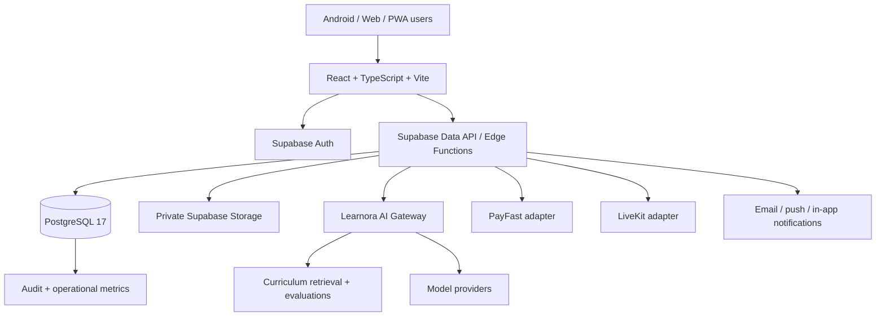

# Learnora target architecture

**Product:** Learnora — Where Potential Becomes Possibility.  
**Initial market:** South Africa  
**Product principle:** Human-centred education, intelligent technology, measurable learning outcomes.

## 1. Product architecture

Learnora is one platform with seven connected operating systems:

1. **Learning experience:** discovery, pathways, courses, lessons, assessments, mastery evidence and offline access.
2. **Educator business:** verification, academies, content studio, learner management, analytics and commercial operations.
3. **Educational intelligence:** model gateway, retrieval, tutor, teacher assistant, assessment assistance, learning analytics, language evaluation and safety.
4. **Educational community:** subject/course communities, discussions, study groups, moderated collaboration and safe communication.
5. **Institutional infrastructure:** tenants, campuses, departments, classes, roles, academic delivery, reporting and interoperability.
6. **Academic record and opportunity:** competencies, evidence, credentials, verified achievements, scholarships and career/learning opportunities.
7. **Commercial operating system:** catalogue pricing, subscriptions, orders, payment reconciliation, refunds, ledger, educator earnings and institutional contracts.

Shared foundations: one identity, one membership/permission model, one learning record, one billing ledger, one audit system and one governed intelligence layer.

## 2. Recommended technical shape

Start with a modular monolith. Keep domain boundaries explicit in frontend and server-side code. Use Edge Functions for privileged operations and integrations. Split background workers or AI services only when throughput, reliability or deployment isolation justifies it.

### Domain boundaries

- **Identity:** auth profile, identities and user preferences.
- **Access:** organisations, memberships, contextual roles, permission checks and guardian relationships.
- **Learning catalogue:** frameworks, subjects, programmes, courses, modules, lessons and resources.
- **Learning delivery:** enrolments, activities, progress events, attempts and learning evidence.
- **Educator operations:** educator verification, academies, publishing workflow and educator analytics.
- **Institution operations:** institution hierarchy, class rosters, timetables and integrations.
- **AI intelligence:** provider routing, prompt/workflow versions, retrieval, evaluations, usage and safety.
- **Community and trust:** communities, membership, discussions, messages, moderation and safeguarding.
- **Commerce:** products/prices, checkout, payment events, ledger postings, refunds and payout workflow.
- **Academic record:** competencies, evidence, credentials and opportunity references.
- **Governance:** audit, consent, retention, export/deletion and admin decisions.

## 3. Seven-system specification

### System 1 — Complete learning experience

**Objective/users:** Help learners, educators and training participants discover and complete structured learning with evidence of mastery.

**Problems/value:** Fragmented content, unclear next steps, passive completion signals and low-connectivity barriers. Learnora provides structured pathways and actionable next learning steps.

**Requirements/workflows:**
- Framework → subject → programme → course → module → lesson → activity → assessment → outcome.
- Configurable curriculum frameworks; CAPS/NSC mapping is data, not hard-coded application logic.
- Discovery filters by level, subject, language, delivery mode, cost, educator and verified credential status.
- Learner workflow: goal → diagnostic baseline → pathway → activity → assessment → feedback → reinforcement → reassessment → evidence-based mastery.
- Separate consumption telemetry from objective/competency evidence. Video completion alone never awards mastery.
- Support live, self-paced, blended, collaborative, video, audio, text, interactive and practical activity types.
- Offline package manifests, authorised downloads, local pending progress events and conflict-safe sync. Assessment submission remains online-authoritative unless a signed offline assessment protocol is separately approved.

**Data:** Reuse courses, modules, lessons, enrolments, learning_objectives, learning_progress, assessments, assessment_questions and assessment_attempts. Add curriculum_frameworks, subjects, programmes, learning_activities, progress_events, competency_definitions and evidence records only after confirming exact boundaries.

**APIs/functions:** course discovery; course detail; enrol; lesson content; record progress event; submit attempt; learner next-action; mastery recomputation. All writes are authenticated and server-validated.

**Permissions:** public catalogue fields may be public; private lessons require entitlement; learners access own progress/attempts; educators manage only academies they control; institutions access only rostered learners in their tenant.

**AI/integrations/security:** retrieval-grounded tutor and explainable recommendations; signed resource URLs; content rights metadata; accessible transcripts/captions; rate-limited sync; never trust client mastery values.

**Revenue/operations:** free and paid course access, learner tiers, sponsored seats. Monitor mastery evidence coverage, completion, assessment improvement and offline sync conflicts.

**Acceptance/testing:** paid content stays locked until verified entitlement; free enrolment is idempotent; learner A cannot read learner B; content version changes preserve historical attempts; video viewing does not set mastery; offline conflict tests preserve assessment records.

**Dependencies/phases:** identity/RLS → catalogue/enrolment/delivery → assessments/progress → offline and AI recommendations.

### System 2 — Educator business infrastructure

**Objective/users:** Enable independent educators and education organisations to operate professional academies.

**Problems/value:** Fragmented website/LMS/payments/analytics and low educator reach. Learnora centralises academy setup, publishing, learner operations and transparent commerce.

**Requirements/workflows:**
- Educator application, evidence upload, review queue and explicit verification decisions.
- Verification states: unverified, pending, additional information required, verified, suspended, rejected.
- Academy branding, public page, team memberships, programme catalogue, learner management, announcements and analytics.
- Content studio with drafts, preview, scheduled publication, versioning and archive.
- AI lesson plans, rubrics and question suggestions remain drafts until educator approval.
- Educator revenue statement distinguishes gross payment, provider fees, refunds, platform commission, accrued earnings, settlement and payout.

**Data:** Reuse academies, courses, modules and lessons. Add educator_profiles, educator_credentials, verification_cases, academy_memberships, content_versions, educator_products, pricing_plans and educator analytics views.

**APIs/functions:** submit verification, review verification, create/update academy, manage academy team, course publishing, content versioning, course analytics, educator statement.

**Permissions:** educator owns own profile; academy owner/admin manages academy; contributor permissions are scoped; platform reviewer controls verification; learner private data is not exported beyond course delivery needs.

**AI/integrations/security:** AI outputs are untrusted drafts; uploaded credentials private; payouts only from reconciled ledger balances; no browser secrets.

**Revenue/operations:** educator subscription tiers and course commissions. Monitor time-to-verify, publication quality, payout disputes and refund rates.

**Acceptance/testing:** unverified educator cannot receive verified badge; one academy cannot mutate another; publishing creates version; content updates do not mutate assessment history; payout request cannot exceed available settled balance.

**Dependencies/phases:** access/organisation → academy and content → commerce → teacher intelligence.

### System 3 — Proprietary Learnora intelligence

**Objective/users:** Improve teaching and learning through owned workflows, retrieval, context, evaluations and governance using interchangeable models.

**Requirements/workflows:**
- Model gateway with provider adapters, routing, timeouts, retries, token/cost ceilings and fallback.
- Versioned workflows: tutor, lesson planning, curriculum mapping, question generation, marking assistance, misconception explanation, language localisation and aggregate academic insights.
- Retrieval corpus with source owner, licence, framework, subject, language, version, provenance and access scope.
- Learner context is minimal, permission-filtered and purpose-bound.
- AI assessment assistance returns rubric evidence, suggested feedback and confidence; educator makes final decisions.
- Learning intelligence explains recommendation evidence and does not label learner intelligence or make exclusion decisions.
- Provider failure never blocks non-AI course delivery.

**Data:** reuse ai_activity. Add ai_conversations, ai_messages, ai_workflow_versions, ai_provider_config (secret references only), knowledge_sources, knowledge_chunks, retrieval_events, ai_evaluations, feedback_events and safety_events.

**APIs/functions:** tutor response, teacher assistant, assessment assist, curriculum retrieval, language evaluation, cost report and model health. Provider calls only server-side.

**Permissions:** AI context broker enforces caller's existing access. No cross-tenant retrieval. Parent and institutional views require explicit scope and guardian/roster authorization.

**Safety/testing:** prompt-injection filtering, source allowlists, output schema validation, age-aware safety, citation validation, red-team suite, provider outage tests, regression evaluation and cost limits.

**Revenue/operations:** free quota and paid AI tiers; track cost per active learner, grounded answer rate, latency and escalation/feedback.

**Acceptance:** no provider key in browser; AI cannot retrieve unauthorized learner/course documents; output never guarantees correctness; objective grading deterministic; subjective grading requires educator confirmation.

**Dependencies/phases:** secure identity and content access → gateway/retrieval → tutor/teacher workflows → evaluations and language expansion.

### System 4 — Educational community and collaboration

**Objective/users:** Enable safe academic collaboration among learners, educators, guardians and institutions.

**Requirements/workflows:** subject/course/grade/academy/institution communities; discussions and Q&A; study groups; resource sharing; collaborative assignments; announcements; notification preferences; reporting, blocking, moderation and appeals.

**Data:** communities, community_memberships, discussions, discussion_replies, resource_shares, group_projects, messages, conversation_memberships, moderation_reports, moderation_actions and notification_events.

**APIs/functions:** create/join community, post/reply, report, block, moderate, send message and publish announcement.

**Permissions/safeguarding:** age-band controls, institution policies, guardian oversight where appropriate, no unrestricted adult-to-minor private messaging, educator/learner communication boundaries, abuse reporting and moderator audit trail.

**Revenue/operations:** community features support retention; no behavioural advertising to minors. Monitor reports, response time, repeat abuse and safe engagement.

**Acceptance/testing:** unauthorized community content inaccessible; blocked users cannot message; minors cannot initiate prohibited adult DMs; moderation actions audited; tenant community boundaries enforced.

**Dependencies:** identity/age safeguards, tenancy and notifications; implement after learning and educator core.

### System 5 — Institutional infrastructure

**Objective/users:** Give schools, universities, colleges, providers and employers a governed learning environment without forcing SIS replacement.

**Requirements/workflows:** institution verification, tenant ownership, organisation → institution → campus → department → programme → class hierarchy, roster/educator allocation, timetable, assignments, assessments, attendance where appropriate and scoped reporting.

**Data:** reuse organisations and organisation_memberships. Add institutions, campuses, departments, academic_terms, classes, class_memberships, educator_allocations, timetables and integration_connections.

**APIs/functions:** tenant provisioning, membership invitation, roster sync, class management, academic report, institution billing and integration webhook.

**Permissions:** tenant ID enforced server-side and in RLS; roles contextual to membership; finance, academic and pastoral data separated; no frontend-only tenant filters.

**Interoperability:** implement LTI 1.3, OneRoster, SCORM, xAPI, OIDC or SAML only to relevant specification and where a real partner requirement exists.

**Acceptance/testing:** cross-tenant reads/writes fail at DB and API levels; revoked membership loses access; imported roster updates are idempotent; integration credentials are encrypted/secret-managed.

**Dependencies:** organisation memberships and policy tests first; institutional hierarchy and reporting after core learner/educator workflows.

### System 6 — Academic intelligence, progression and opportunity

**Objective/users:** Maintain portable, evidence-backed academic development and surface relevant opportunities.

**Requirements/workflows:** learner-controlled or institution-governed academic profile; competency frameworks; evidence links to assessment/practical work; verified vs self-reported distinction; credentials with issuer/identifier/verification/revocation; opportunities with source, deadline, eligibility, last-verified date and link.

**Data:** competency_frameworks, competencies, competency_prerequisites, learner_evidence, mastery_decisions, credentials, credential_events and opportunities.

**APIs/functions:** learner record export, evidence capture, competency evidence review, credential issue/verify/revoke, opportunity ingestion and eligibility explanation.

**Permissions:** learners/guardians/institutions see only authorized scopes; credential verification exposes minimum public claims; no automated consequential progression decision.

**AI/security:** recommendations are explainable, advisory and non-exclusionary; opportunities require provenance and expiry checks.

**Revenue/operations:** institutional intelligence and premium progression tools; monitor evidence quality, credential verification and stale opportunity rate.

**Acceptance/testing:** forged/self-reported achievements never appear as verified; revoked credentials fail verification; learner data export is complete and authorized; expired opportunities are flagged.

**Dependencies:** assessment evidence, identity, privacy and competency model.

### System 7 — Commercial operating system and acquisition

**Objective/users:** Sustain Learnora while keeping essential access affordable.

**Requirements/workflows:** configurable products/prices, learner and educator subscriptions, course checkout, coupons, scholarships/sponsored seats, institution contracts, payment notification verification, idempotent webhooks, refunds, reconciliation, double-entry ledger and payout records.

**Data:** products, prices, subscriptions, orders, order_items, payment_transactions, payment_events, refunds, ledger_accounts, ledger_journals, ledger_entries, educator_earnings, payout_records and reconciliation_runs.

**APIs/functions:** create checkout, PayFast ITN/webhook verification, subscription state update, refund request, reconcile, accrue commission, payout eligibility and statement export.

**Permissions:** checkout server-priced; webhook verified; ledger writes server-only; educator reads own statement but cannot modify ledger; finance roles scoped to tenant/platform.

**Financial states:** initiated → authorised/confirmed → settled; refunds initiated → completed; earnings accrued; payout initiated → completed. A payment callback does not prove bank settlement.

**Legal/operations:** validate PayFast marketplace/settlement permissions and relevant financial rules before educator withdrawals. No live payment settings changed during foundation work.

**Acceptance:** duplicate webhook idempotent; invalid webhook rejected; unpaid order cannot unlock content; refund cannot double-post; ledger balanced; payout requires reconciled settled funds.

**Dependencies:** product catalogue and server security → provider sandbox → reconciliation/ledger → payout only after provider/legal approval.

## 4. Shared identity and permission architecture

One Supabase Auth user can hold several contextual memberships. A global role is not a substitute for organisation membership. Every privileged request derives the actor from the verified JWT, then resolves active membership, resource scope and permission server-side.

| Context | Principal permissions |
|---|---|
| Anonymous visitor | Published public catalogue and public academy pages only |
| Learner | Own profile, enrolments, progress, attempts, authorized communities |
| Educator | Own educator profile; academy resources within granted role |
| Academy owner/admin | Manage academy, team, courses and scoped learner operations |
| Parent/guardian | Only linked learner data covered by consent and policy |
| Institution owner/admin | Tenant configuration, membership and permitted reporting |
| Academic manager/department head | Scoped academic records and interventions |
| Educator/assistant in institution | Assigned classes and learners only |
| Finance administrator | Scoped invoices, transactions and reconciliation views |
| Platform support/moderator | Explicit case-scoped access, reason and audit trail |
| Platform administrator | Least-privilege platform operations; sensitive access audited |

All policies require tests for anonymous, authenticated, cross-user, cross-academy, cross-tenant, revoked membership and service-role paths. Never trust a role supplied by the browser.

## 5. API and server function conventions

Use versioned domain-oriented Edge Function names and stable response envelopes. Validate every input with runtime schemas; derive user identity from JWT; authorize against database state; return safe error codes; log request IDs without secrets or unnecessary learner data.

| Function | Responsibility | Auth/rate control |
|---|---|---|
| `course-discovery` | Published course search | Public/authenticated, pagination and abuse limits |
| `enrol-course` | Free or entitled enrolment | Authenticated, idempotency key |
| `record-learning-event` | Progress evidence | Authenticated, enrolment check, per-user limits |
| `submit-assessment` | Attempt submission and deterministic objective marking | Authenticated, active enrolment, attempt limits |
| `educator-verification` | Evidence intake and status workflow | Educator submit; reviewer role decide |
| `publish-course` | Validate and publish content version | Academy manager |
| `learnora-ai` | Model-independent AI gateway | Authenticated, scoped context, quota/cost controls |
| `payfast-itn` | Verify payment notification | Provider verification, idempotent |
| `reconcile-payments` | Match provider events and ledger | Finance/service role only |
| `issue-credential` | Issue verifiable credential | Authorized issuer, audit |
| `moderation-case` | Report/review/decision | User report; moderator case scope |

## 6. Database evolution plan

Retain the existing 15 tables as the canonical initial learning/organisation schema. Do not create duplicates for profiles, courses, enrolments, progress, assessments or audit events.

Future schema additions are grouped by domain:
- Frameworks and programmes.
- Educator verification and academy teams.
- Institutions/campuses/departments/classes.
- Guardians and consent.
- Content versioning and learning activity evidence.
- AI workflow/retrieval/evaluation.
- Community/messaging/moderation.
- Commerce/ledger/reconciliation.
- Competencies/credentials/opportunities.
- Retention/export/deletion and integration registry.

Each migration must be forward-only, reviewed for locks/backfills, accompanied by RLS and negative tests, and applied first to a disposable branch/staging database. Production DDL requires explicit authorization.

## 7. Security, privacy and safeguarding

- POPIA purpose limitation, minimisation, access/correction, retention and incident response.
- Child-appropriate onboarding and consent/legal review for minors.
- Private buckets and signed URLs; MIME/size limits, malware scanning plan and retention.
- AI context retrieval applies the same authorization as the requesting user.
- No confidential learner data sent to models without an approved processor, purpose and contractual basis.
- Secret manager for AI, PayFast, LiveKit and integration secrets.
- Audit administrative access, verification decisions, financial transitions and credential issuance.
- Copyright metadata and content takedown workflow.
- Qualified South African legal review before compliance claims, accreditation claims or regulated commercial activity.

## 8. Commercial model and unit economics

Price tiers are configuration, not hard-coded UI:
- Learner: Free / Plus / Premium.
- Educator: Starter / Professional / Academy.
- Institution: Small / Growing / Enterprise.
- Organisation: negotiated plan.

Evaluate contribution margin by segment:

`Contribution = net revenue - payment fees - educator share - refunds - AI cost - media delivery - support - attributable infrastructure`

Measure AI cost per active learner, video GB delivered per learner, payment success, educator net payout, CAC, LTV, churn and support cost. Do not publish prices until South African willingness-to-pay, competitors, costs and target margin are researched.

## 9. South African market entry

Initial focus: Giyani and surrounding Limpopo communities, then wider South Africa. Start with credible independent tutors, matric/NSC support and useful CAPS-aligned resources. Build educator supply and quality before broad learner acquisition. Use transparent founding-educator terms, community partnerships, school pilots and free learning resources. No fabricated success metrics or accreditation claims.

Competitor study: Khan Academy (free structured learning), Google Classroom (classroom workflow), Moodle (institutional flexibility), Udemy (creator marketplace) and Coursera (credential/partner ecosystem). Learnora's differentiation is the integrated educator business + evidence-based learning progression + South African context + institutional tenancy + guarded AI. This is a strategic hypothesis requiring user research, not a proven market advantage.

## 10. Implementation sequence

0. Audit and architecture — completed as documentation; no production schema changes.
1. Foundation — app shell, auth, profile lifecycle, permission helpers, design system and CI.
2. Learning/educator — academy, course studio, discovery, enrolment, learning events and assessment.
3. Commerce — sandbox payment verification, ledger and reconciliation.
4. AI — gateway, retrieval, tutor/teacher workflows and evaluations.
5. Community — moderation, study groups, safe messaging and live classrooms.
6. Institutions — tenancy hierarchy, roster, class delivery, reporting and integrations.
7. Academic intelligence — competency evidence, credentials and opportunities.
8. Launch readiness — independent security, accessibility, performance, AI, payment, safeguarding and recovery validation.

## 11. Definition of done

A feature is complete only when database changes, server authorization, UI, loading/empty/error states, tests, accessibility, mobile layout, operational logs and documentation are in place. A successful code commit is not a successful build, deployment or production release. Report evidence and limitations explicitly.
